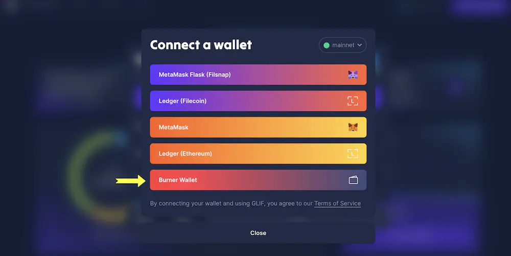
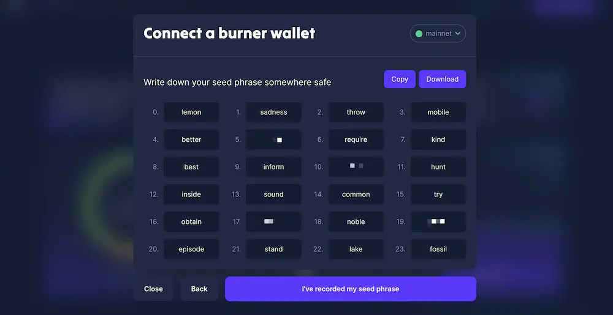
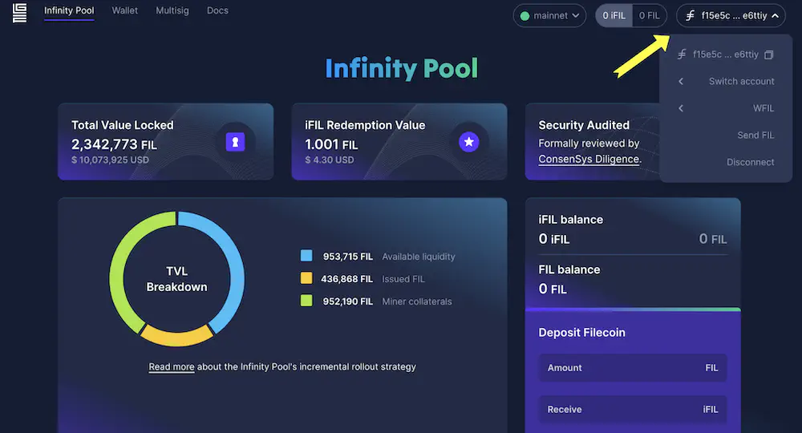
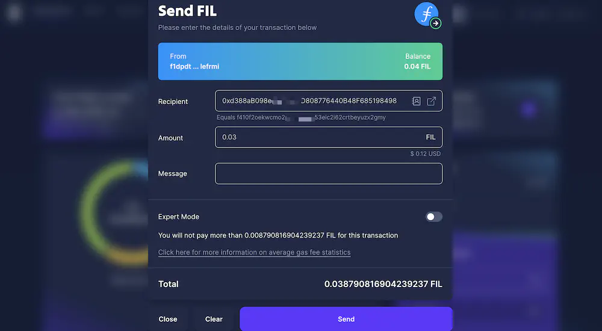

# Transfer FIL

**Filecoin has native `f` addresses and Ethereum-style `0x` addresses, so how you move FIL depends on the address type you send from and to. There are four paths.**

An `0x` address is the Ethereum form of an `f410` address. See [Addresses](../concepts/addresses.md).

|  | From an `0x` address | From an `f` address |
| --- | --- | --- |
| **To an `0x` address** | [`0x` to `0x`](#0x-to-0x) | [`f` to `0x`](#f-to-0x) |
| **To an `f` address** | [`0x` to `f`](#0x-to-f) | [`f` to `f`](#f-to-f) |


**Assets on the Filecoin network are not available on any other network.** Filecoin works with Ethereum wallets and tools, but you are not using the Ethereum network. These steps move FIL only within Filecoin. To add Filecoin to your Ethereum wallet, see [Wallets](wallets.md#add-filecoin-to-metamask).


## `0x` to `0x`

Both addresses are `f410` addresses written as `0x`. Use your Ethereum wallet, such as MetaMask, as you would to send on Ethereum.

To convert between the two forms, use the [Beryx address converter](https://beryx.zondax.ch/address_converter), or search an `0x` address on [Filfox](https://filfox.info/en), which shows both forms.

## `0x` to `f`

Ethereum wallets don't recognize `f1`, `f2` or `f3` addresses, so you can't send to them directly. Use FilForwarder.

### FilForwarder

FilForwarder is a smart contract with a `forward` method. It takes an `f` address in byte form and an amount, and sends the FIL there, creating the destination actor if it is new. It is deployed at the same address on all Filecoin networks:

```text
0x2B3ef6906429b580b7b2080de5CA893BC282c225
```

Don't trust a contract that claims to be FilForwarder at any other address.

Before you start, make sure you know the destination address and that your `0x` address holds enough FIL to cover gas.

**With Glif**

1. Go to [Glif](https://glif.io/en), select the network, and click **Connect Wallet**.
2. Confirm the connection in your wallet.
3. Select your wallet address and click **Forward FIL**.
4. Enter the destination address and the amount.
5. Check the destination address, then click **Send**.
6. Click the transaction ID to follow it. The FIL arrives in about two minutes. If you can't see it, make sure your block explorer is on the right network.

**With Hardhat**

You need [Yarn](https://yarnpkg.com/) and a Filecoin address in [MetaMask](wallets.md#add-filecoin-to-metamask). You can also call the contract from Remix.

1. Clone the repository and install its dependencies:

   ```shell
   git clone https://github.com/FilOzone/FilForwarder
   cd FilForwarder
   yarn install
   ```
2. Set your private key as an environment variable:

   ```shell
   export PRIVATE_KEY='<YOUR PRIVATE KEY>'
   ```

   Never hardcode your private key or commit it to source control. Anyone with it controls your funds.
3. Run the `forward` task:

   ```shell
   yarn hardhat forward \
       --network <NETWORK> \
       --destination <DESTINATION_ADDRESS> \
       --amount <AMOUNT>
   ```

   * `NETWORK` is `mainnet` or `calibration`.
   * `DESTINATION_ADDRESS` is an `f`-style address, such as `t3tejq3lb3szsq7spvttqohsfpsju2jof2dbive2qujgz2idqaj2etuolzgbmro3owsmpuebmoghwxgt6ricvq` or `t01024`.
   * `AMOUNT` is in FIL. `3.141` sends 3.141 FIL.

For example, to send 9 FIL to a `t3` address on [Calibration](../networks/calibration.md):

```shell
yarn hardhat forward \
    --network calibration \
    --destination t3tejq3lb3szsq7spvttqohsfpsju2jof2dbive2qujgz2idqaj2etuolzgbmro3owsmpuebmoghwxgt6ricvq \
    --amount 9.0
```

## `f` to `0x`

Most wallets and exchanges support `f1` and `f3` addresses, and many support `f4` and `0x` as well, including OKX, Kraken and Btcturk. Some are still adding support. If yours doesn't let you send to an `f4` or `0x` address, ask its support team to add it.

The steps depend on where you send from.

### Ledger

Ledger Live can send to an `f4` address. Look up the `f4` equivalent of your `0x` address on any [block explorer](../networks/mainnet.md) and send to that.


Ledger Live can't send to an `0x` address directly. Use the `f4` equivalent.


### Hot wallet

If your wallet or exchange can't send to `f4` or `0x` addresses, relay the FIL through a burner wallet:

1. Go to [Glif](https://www.glif.io/en?txtype=send) and create a **Burner wallet**.

   
2. Click **Create Seed Phrase** and write the phrase down somewhere safe. You need it later.

   
3. Click **I've recorded my seed phrase**, fill in the missing words, then click **Next** and **Connect**.
4. Copy the wallet's address from the top left of the dashboard.

   
5. From your main wallet or exchange, send your FIL to that address.
6. In MetaMask, copy your `0x` address.
7. Once the FIL arrives in the burner wallet, click **Send FIL**.
8. Enter your `0x` address as the **Recipient**. Glif converts it to an `f4` address. Enter the **Amount**, leaving enough to cover gas.

   
9. Click **Send**. The FIL reaches MetaMask shortly.

### Exchange

Check that the exchange can withdraw FIL to an `0x` or `f410` address. If not, you need extra steps. For example, see [how to transfer FIL from Coinbase to a MetaMask wallet](https://filecointldr.io/article/guide-how-to-transfer-fil-from-coinbase-to-a-metamask-wallet-0x).

## `f` to `f`

No special steps are needed. Send as you would with any wallet.

## Next steps

* [Wallets](wallets.md)
* [Addresses](../concepts/addresses.md)
* [Get FIL](get-fil.md): buy FIL and withdraw it safely.

[Was this page helpful?](https://airtable.com/apppq4inOe4gmSSlk/pagoZHC2i1iqgphgl/form?prefill_Page+URL=https://docs.filecoin.io/protocol/fil/transfer-fil)
