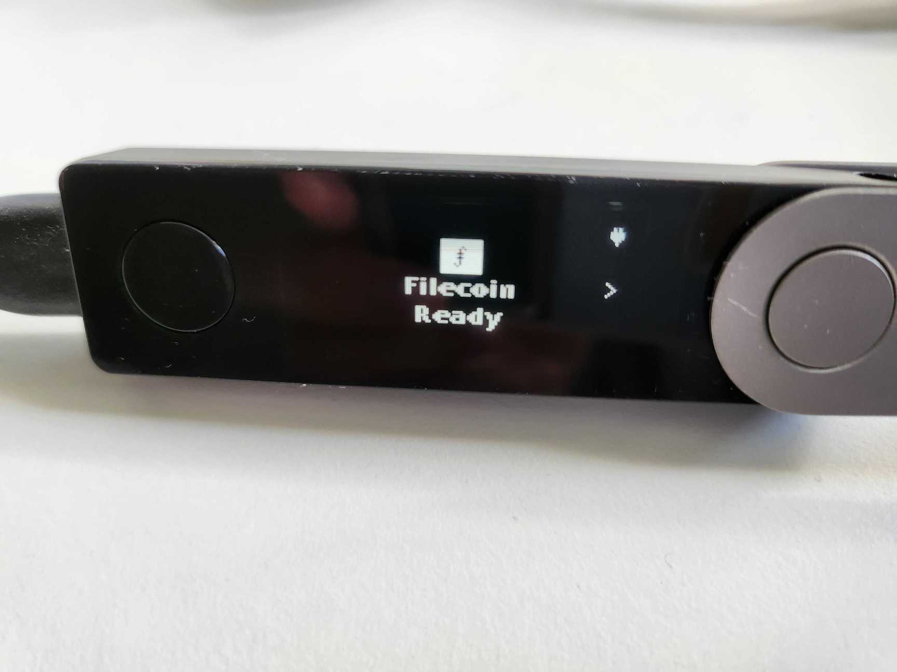
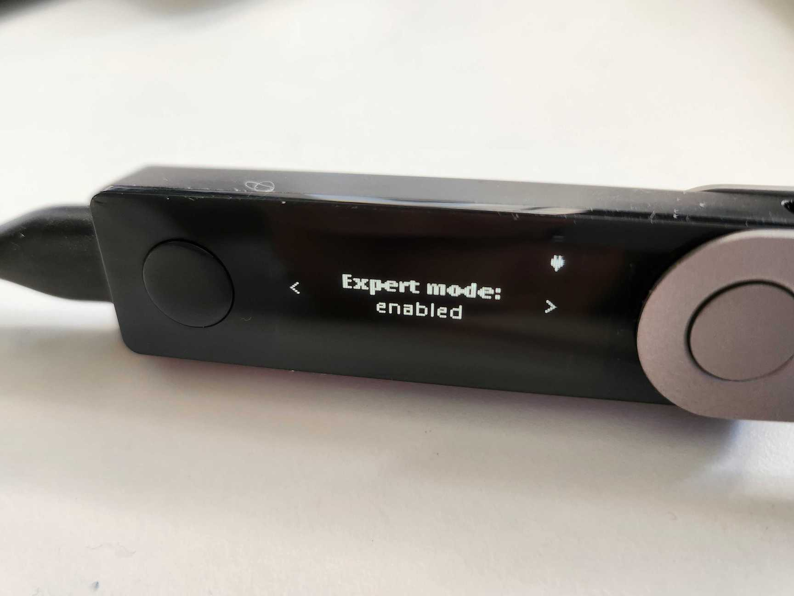
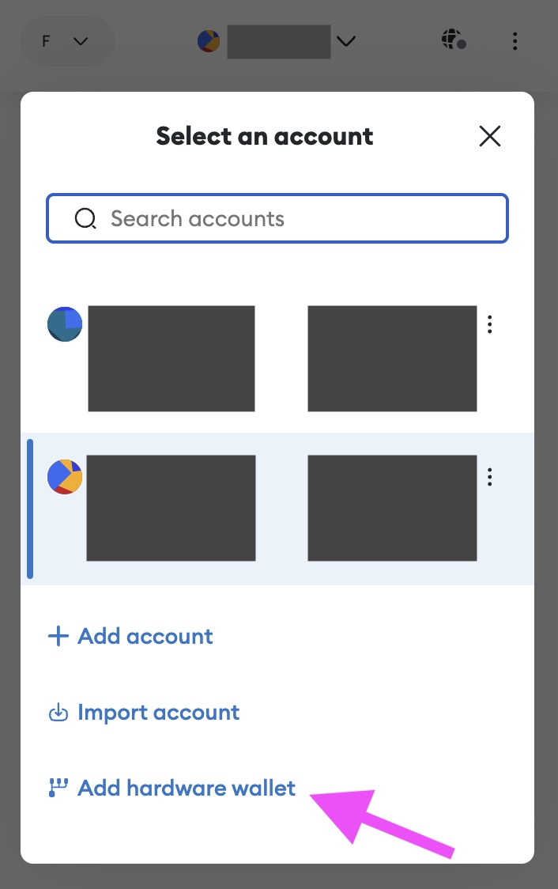
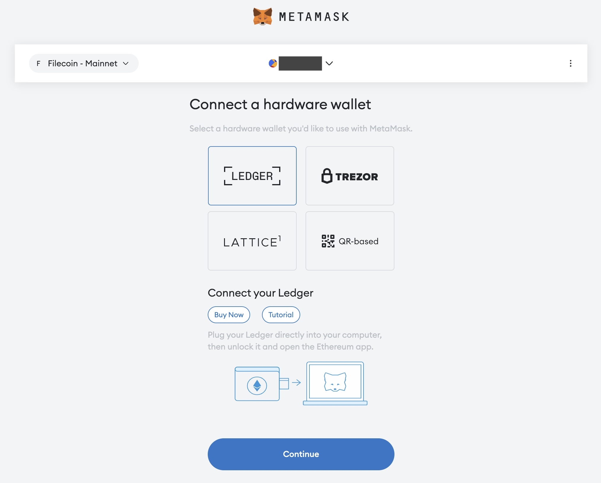
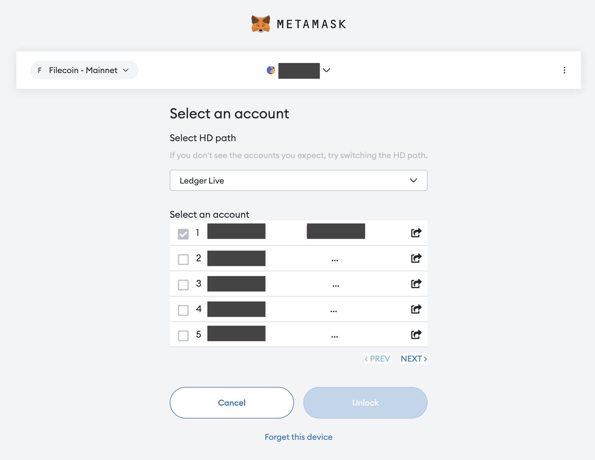
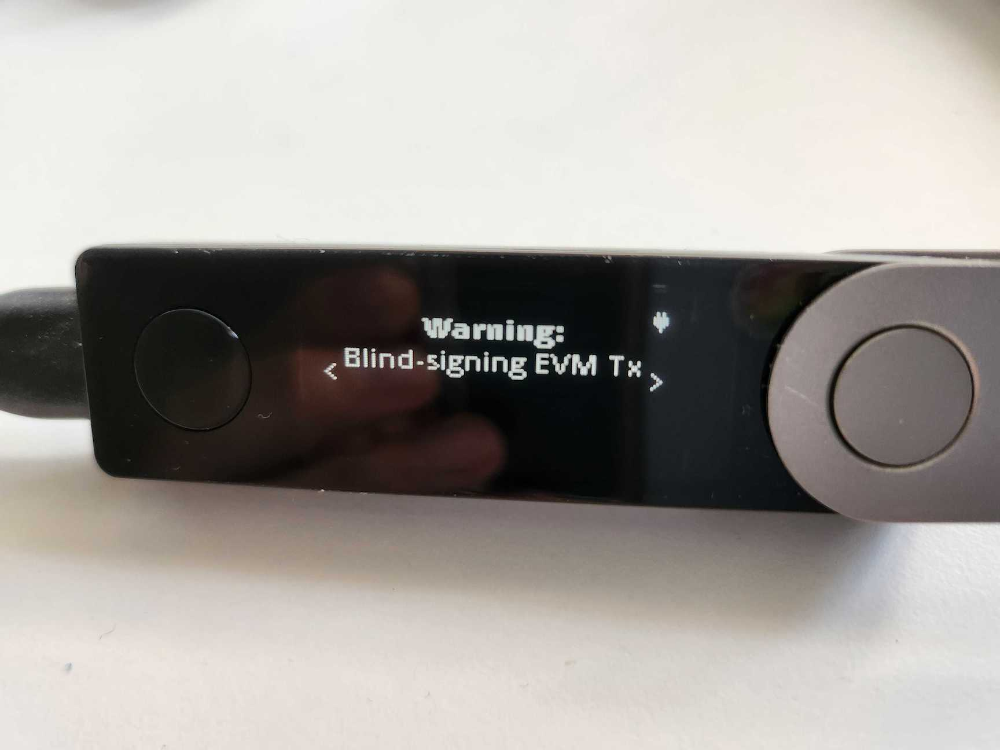

# Wallets

**A wallet holds the keys that control your FIL. When someone sends FIL to your address, the transaction is recorded onchain and your balance goes up. When you send FIL, it goes down.**

Wallets differ in features and security: desktop, mobile, hardware and web wallets each make a different trade-off, so choose a reputable one.

## Compatible wallets

Filecoin does not provide technical support for these wallets, so take care when you research and use them. A wallet marked _Recommended_ has had its open-source code audited by a reputable third party.

If you already run a Lotus node, you can also [manage FIL wallets from the command line](https://lotus.filecoin.io/lotus/manage/manage-fil/).

| Name | Description | Audited |
| --- | --- | --- |
| [Ledger](https://support.ledger.com/article/4402721277329-zd) | A multi-currency hardware wallet. _Recommended._ | Yes |
| [Glif web wallet](https://www.glif.io/en?txtype=send) | Sends and receives FIL. Can be used with a Ledger. _Recommended._ | Yes |
| [FoxWallet](https://foxwallet.com/) | A multi-currency mobile wallet by [Filfox](https://filfox.info/en). | Yes |
| [Brave Wallet](https://brave.com/wallet/) | A multi-currency software wallet built into the Brave browser. | Yes |
| [D'CENT Wallet](https://www.dcentwallet.com/en) | A hardware and mobile wallet that supports Filecoin mainnet, with `f1` and `f4` addresses. | Yes |

An audit does not make a wallet bug-proof. Only wallets with a public audit are listed here.

### Hot and cold wallets

A _hot_ wallet is always connected to the internet: a mobile, desktop or browser wallet. It is quick to use but exposed to online attacks, so keep only the funds you need often in it.

A _cold_ wallet is usually a hardware device that is offline except when you sign a transaction. Using it takes physical possession of the device and your PIN, which makes it harder to steal from. It is less convenient, and best for larger balances.

### Security

Never share your seed phrase, password or private keys. Attackers often pose as customer support or send phishing emails to get them.

## Add Filecoin to MetaMask

MetaMask works with Filecoin's Ethereum-style `0x` addresses. To use native `f` addresses, use Glif, Ledger Live with the Filecoin Ledger app, or [FilSnap](#use-native-addresses-with-filsnap).

### Use native addresses with FilSnap

[FilSnap](https://snaps.metamask.io/snap/npm/filsnap/) is a MetaMask [Snap](https://metamask.io/snaps/) that adds native Filecoin `f` addresses to MetaMask. Install it from the **Snaps** option in MetaMask's menu. Its code has been audited.

### Using ChainID

[chainid.network](https://chainid.network) is the simplest way to add Filecoin to MetaMask.

1. Go to [chainid.network](https://chainid.network).
2. Search for the network you want: `Filecoin Mainnet`, `Filecoin Calibration` or `Filecoin Local testnet`.
3. Click **Connect Wallet**.
4. Click **Approve** when asked to _Allow this site to add a network_.
5. For a testnet, MetaMask may warn that you are connecting to a test network. Click **Accept**.
6. Click **Switch network**.
7. Open MetaMask. The network is listed at the top.

### Manually

You need a Chromium-based browser or Firefox with [MetaMask](https://metamask.io/) installed.

1. Open MetaMask. If you haven't used it before, follow the prompts to create a wallet.
2. Click the user circle and select **Settings**, then **Networks**.
3. Click **Add a network**, then **Add a network manually**.
4. Enter the values for your network exactly as shown:

| Field | Mainnet | Calibration | Local testnet |
| --- | --- | --- | --- |
| Network name | `Filecoin` | `Filecoin Calibration testnet` | `Filecoin Local testnet` |
| RPC URL | `https://api.node.glif.io/rpc/v1` | `https://api.calibration.node.glif.io/rpc/v1` | `http://localhost:1234/rpc/v1` |
| Chain ID | `314` | `314159` | `31415926` |
| Currency symbol | `FIL` | `tFIL` | `tFIL` |

5. Optionally, enter a block explorer URL from [Networks](../networks/README.md).
6. Click **Save**.

## Connect a Ledger to MetaMask

MetaMask works with the Filecoin Ledger app.

> **Warning:** The Ethereum Ledger app no longer works for Filecoin as of v1.15.0. Earlier versions still do. Use the Filecoin Ledger app.

### Install the Ledger app

1. Open Ledger Live and go to **My Ledger**.
2. Connect and unlock your Ledger, and allow My Ledger to access it by pressing both buttons at once.
3. In **App catalog**, search for **Filecoin** and click **Install**.

See the [Ledger documentation](https://support.ledger.com/article/4402721277329-zd) for details.

### Enable Expert mode

MetaMask requires the Filecoin app to be in _Expert mode_.

1. Open the Filecoin app on your Ledger.

   
2. Navigate to **Expert mode**.

   
3. Press both buttons at once to enable it.

### Connect to MetaMask

1. Open MetaMask. In the **Accounts** menu, select **Add hardware wallet**.

   
2. Select **Ledger**.

   
3. Select an account that starts with `0x`.

   

When you send a transaction from this account, the Ledger asks you to confirm it. You may see a _blind signing_ warning. This is expected, and it is why Expert mode must be on.

## Add a wallet to this list

To suggest a wallet, open an issue in [`filecoin-project/filecoin-docs`](https://github.com/filecoin-project/filecoin-docs) with its name and features. A mobile wallet must be available on both Android and iOS. The wallet must have been audited, and the audit results must be public.

## Next steps

* [Get FIL](get-fil.md)
* [Transfer FIL](transfer-fil.md)
* [Addresses](../concepts/addresses.md): the five address types and how they map to 0x.
* [Mainnet](../networks/mainnet.md): parameters, RPC endpoints and explorers for the production network.

[Was this page helpful?](https://airtable.com/apppq4inOe4gmSSlk/pagoZHC2i1iqgphgl/form?prefill_Page+URL=https://docs.filecoin.io/protocol/fil/wallets)
