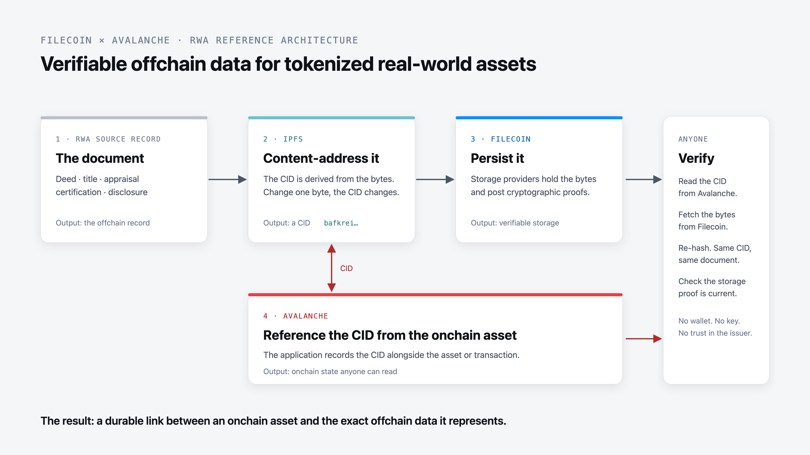

# Real-world assets reference architecture

**A tokenized real-world asset points to offchain records, such as deeds, appraisals and certifications. This architecture stores those records with IPFS and Filecoin and references their CIDs from your onchain application, so anyone can check that a record is exactly the one the asset points to.**

To run the working demo yourself, follow [Store RWAs with IPFS](../../../guides/store-rwas-with-ipfs.md).

## The problem

An onchain asset depends on offchain records to say what it represents. If those records live only in the issuer's database or cloud account, every application that uses the asset has to trust that infrastructure to keep the records and not change them.

IPFS and Filecoin give you a verifiable data layer for them. IPFS identifies the exact content, Filecoin stores it and proves that it is still stored, and your onchain application records the CID.

## The components

| Component | What it does | Output |
| --- | --- | --- |
| RWA source record | The deed, title, appraisal, certification or disclosure | The document |
| IPFS | Content-addresses the record | A CID derived from the bytes |
| Filecoin | Stores the data and proves it is kept | Verifiable storage, backed by proofs |
| Onchain application | Records the CID with the asset or transaction | Onchain state |

The reference implementation uses Avalanche for the onchain application. The pattern works on any EVM chain.

## How it works

1. **Store the source record.** The issuer adds an offchain record, such as a deed.
2. **Create a content-addressed reference.** IPFS makes a CID from the content. If the record changes, its CID changes.
3. **Store it on Filecoin.** Storage providers keep the data and prove it on a schedule.
4. **Record the CID onchain.** The application writes the CID next to the asset or transaction.
5. **Verify independently.** A third party fetches the record and checks that its CID matches the one the application recorded.

Verification here means that this content was stored and that the retrieved content matches its CID. It doesn't tell you whether the deed is legitimate.

## What each layer provides

| Layer | Role |
| --- | --- |
| Onchain application | Asset state, transactions, and the reference to the record |
| IPFS | Content addressing and integrity checking |
| Filecoin | Durable storage backed by cryptographic proofs |

This gives you three things. You can tell whether a record has changed. You depend less on one application's database or cloud provider. And the same content-addressed data can be referenced from other applications and infrastructure.

## Example: a property record

The demo publishes a synthetic record set for a property at 123 Main Street: a deed, a survey, a parcel file and two tax assessments, issued by a county recorder. Each file is content-addressed with IPFS and stored on Filecoin. A manifest lists the files, and the manifest's CID is recorded on Avalanche.

A tokenized property can reference many records over its life: deeds, parcel data, appraisals, inspections and disclosures. An RWA platform can content-address each one, store it on Filecoin, and reference the CIDs from its application, instead of putting the documents themselves onchain.

If one line of the deed changes, so does its CID, and the check fails:

| Document | CID |
| --- | --- |
| `deed.pdf` (original) | `bafkreidh5qsi5z6uo2thzvynr27ioajoviafqiveunrielhugyj65l6rzu` |
| `deed-tampered.pdf` (one line edited) | `bafkreiausintabvl4n4hvgv2jdmazvy35bg26gku2ufu2bosxhrd7dzxqi` |

## The implementation

The [implementation](https://github.com/SgtPooki/Avalanche-IPFS-Filecoin-RWA-reference-Architecture) does three things:

* It stores the bytes with [Filecoin Cloud](../../../store-data/overview/filecoin-cloud.md), through the Filecoin SDK.
* It anchors a pointer to the manifest in a plain EVM registry contract on Avalanche.
* It verifies by hashing the retrieved bytes again and reading the proof state of the data set.

It builds on the [Avalanche and Filecoin data bridge](https://www.avalanche.com/about/blog/avalanche-and-filecoin-launch-cross-chain-data-bridge-for-scalable-web3) announced in May 2025.

To adapt it, see the implementation's [description of what the issuer publishes](https://github.com/SgtPooki/Avalanche-IPFS-Filecoin-RWA-reference-Architecture#what-the-issuer-publishes) and its [fork map](https://github.com/SgtPooki/Avalanche-IPFS-Filecoin-RWA-reference-Architecture#fork-map).

## Next steps

* [Store RWAs with IPFS](../../../guides/store-rwas-with-ipfs.md): run the demo and verify its records.
* [Keep immutable, auditable records](../../../guides/keep-immutable-auditable-records.md)
* Building RWAs on Avalanche? [Talk to the Filecoin team](https://filecoin.cloud/contact).
* [Filecoin.sol](../filecoin.sol.md): call built-in actors from Solidity.
* [Manual storage deals](../../manual-storage-deals.md): negotiate and record a deal directly with a provider.
* [Filecoin Virtual Machine](../README.md): what the FVM is and where to start.
* [FVM advanced](../advanced/README.md): tools and services for FVM developers.

[Was this page helpful?](https://airtable.com/apppq4inOe4gmSSlk/pagoZHC2i1iqgphgl/form?prefill_Page+URL=https://docs.filecoin.io/protocol/fvm/cookbooks/rwa-reference-architecture)
