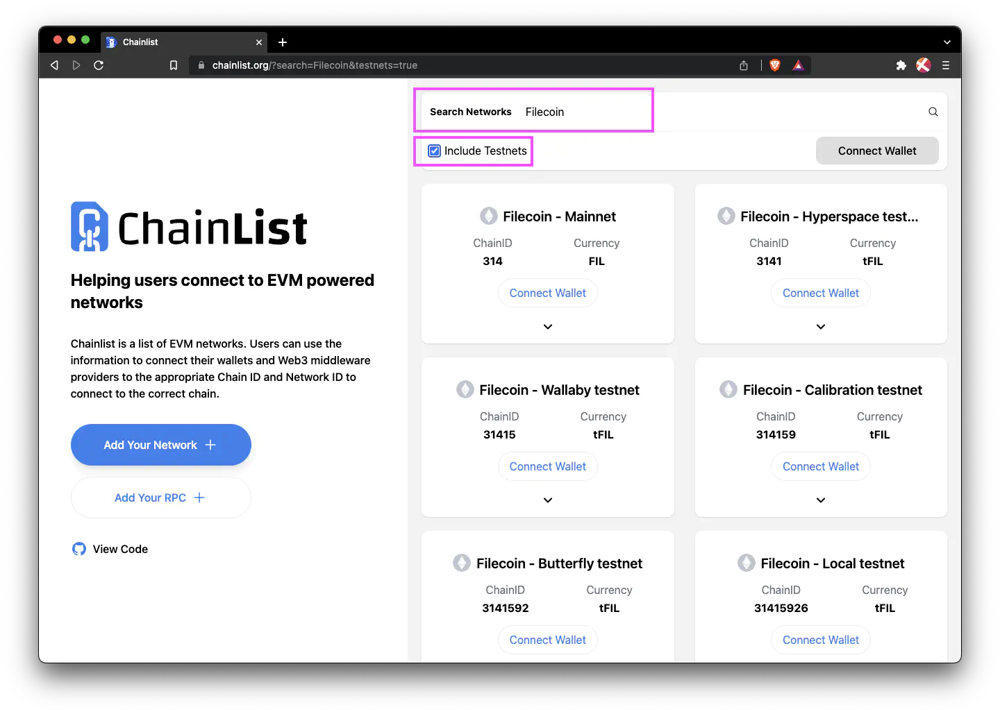
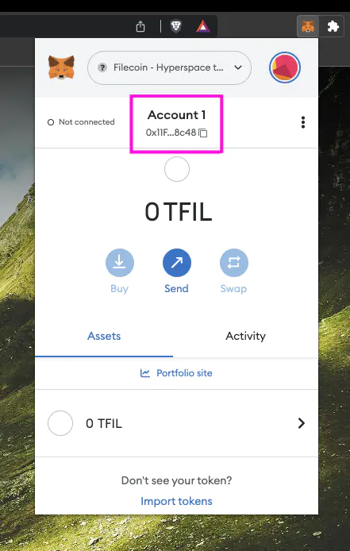
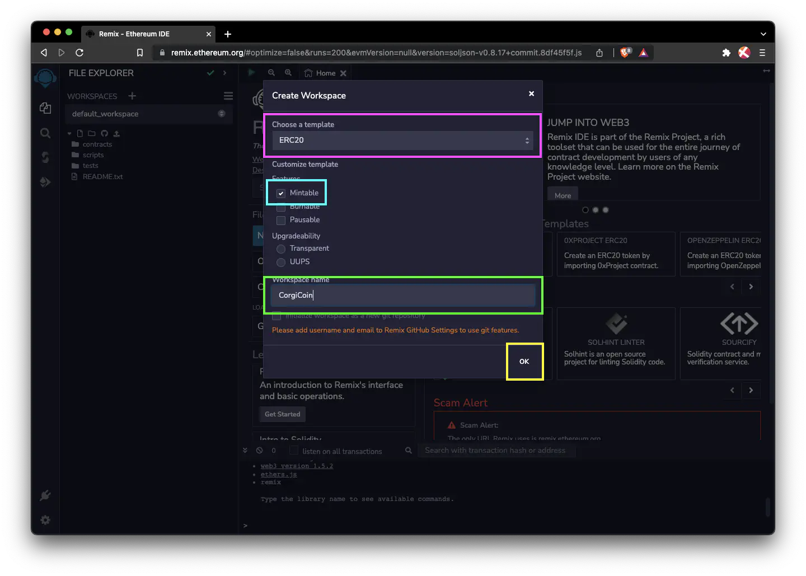
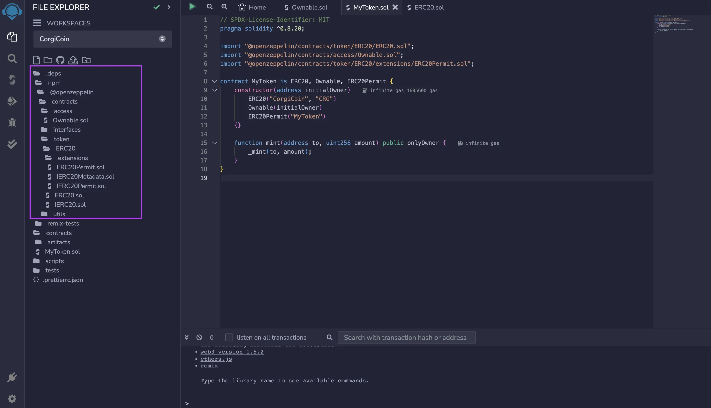
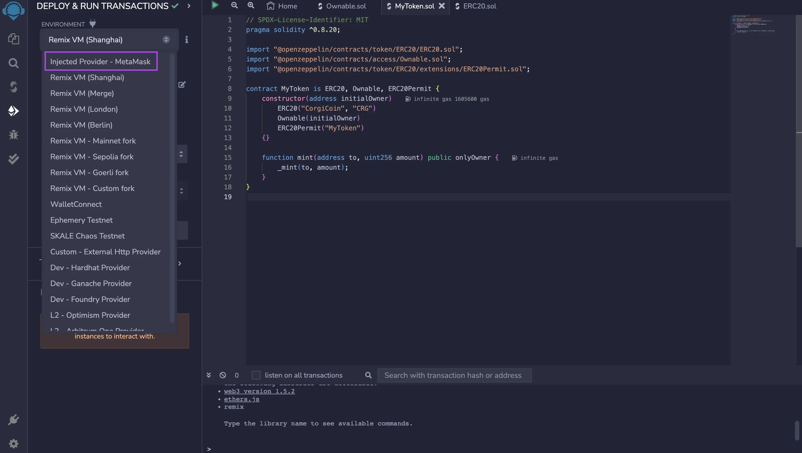
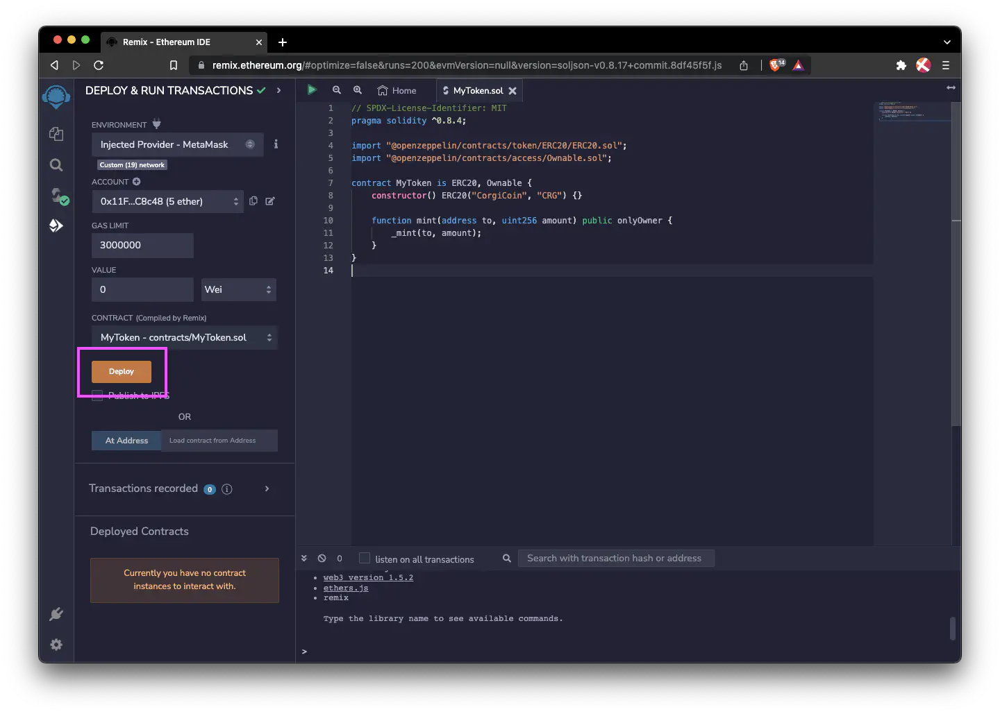
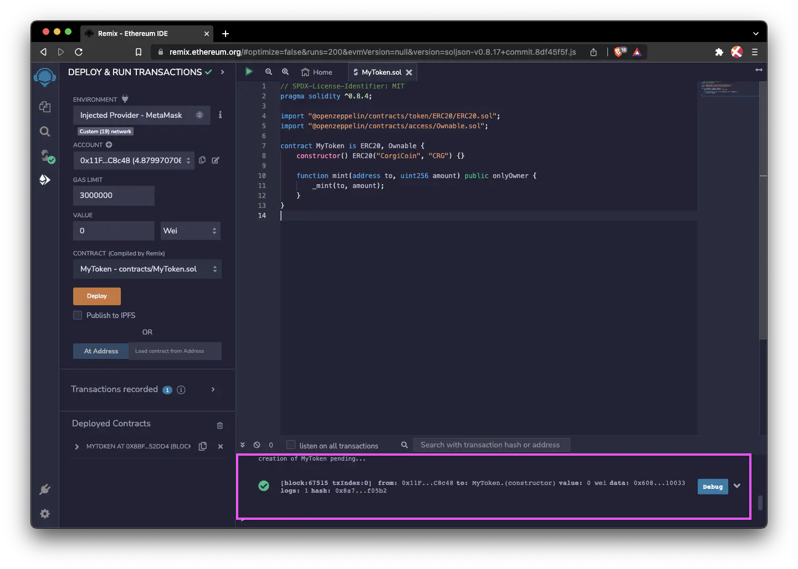
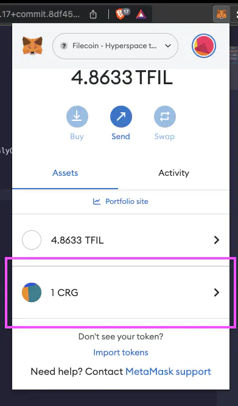

# Quickstart: ERC-20

**In this tutorial you deploy an ERC-20 token to the Calibration testnet. You set up MetaMask, get free test FIL, deploy the contract from Remix, and mint tokens to your wallet.**

It takes about 20 minutes, and it uses test FIL only, so it costs nothing.

## Set up your wallet

1. Install [MetaMask](https://metamask.io/) in your browser and create a new wallet. Choose a password, and save your Secret Recovery Phrase somewhere safe.
2. Add the Calibration testnet to MetaMask. Go to [chainid.network](https://chainid.network), search for `Filecoin Calibration`, click **Connect Wallet**, then approve the new network and switch to it. For the manual steps, see [Wallets](../fil/wallets.md#add-filecoin-to-metamask).

   
3. Open MetaMask. The network at the top is _Filecoin Calibration_, and your balance is `0 tFIL`.

## Get test FIL

1. In MetaMask, copy your address.

   
2. Go to the [Chainsafe faucet](https://faucet.calibnet.chainsafe-fil.io), paste your address and click **Send Funds**.
3. The faucet shows a transaction ID. To follow it, paste it into a [Calibration block explorer](../networks/calibration.md#block-explorers). After a couple of minutes, `tFIL` arrives in your wallet.

## Create the contract

You use [Remix](https://remix.ethereum.org/), a browser-based development environment.

1. Open Remix. In the workspace menu, click **Create a new workspace**.
2. For the template, choose **ERC20**. Under **Features**, check **Mintable**. Name the workspace, for example `CorgiCoin`, and click **OK**.

   
3. Open the compiler panel and select compiler version `0.8.20`.
4. Under **contracts**, open `MyToken.sol`. Replace `MyToken` with your token's name, such as `CorgiCoin`, and replace the second string with its symbol, such as `CRG`. The contract imports OpenZeppelin's ERC-20 code, so it stays short.

## Compile

Click the green play button, or press `Cmd+S` on macOS or `Ctrl+S` on Linux and Windows. Remix fetches the three imported contracts and lists them under `.deps`.

## Deploy

1. Open the **Deploy** tab. For **Environment**, choose **Injected Provider - MetaMask**.

   
2. In MetaMask, click **Next** and **Connect** to link your account to Remix.
3. Back in Remix, the **Account** field shows a balance such as `5 ether`. That is your `tFIL`. Remix doesn't know the Filecoin network, so it labels the balance as ether.
4. Make sure your contract is selected under **Contract**. Paste your MetaMask address into the deploy field. It becomes the token's owner.
5. Click **Deploy**, then confirm the transaction in MetaMask.

   
6. Wait for the deployment to finish. A new [tipset](../concepts/blocks-and-tipsets.md) is created every 30 seconds, and the network usually needs one or two of them, so allow 60 to 90 seconds.

   

## Mint tokens

1. Open **Deployed Contracts** in the **Deploy** tab and expand the `mint` method.
2. In `to`, paste your MetaMask address.
3. In `amount`, enter the amount in the token's smallest unit. An ERC-20 token has 18 decimals, so `100` tokens is `100` followed by 18 zeros: `100000000000000000000`.
4. Click **Transact** and confirm the transaction in MetaMask. This also takes about 90 seconds.

## Add the token to MetaMask

MetaMask doesn't know your token yet. Tell it the contract's address.

1. In Remix, under **Deployed Contracts**, click the copy icon next to your contract's address.
2. In MetaMask, select **Assets** and click **Import your tokens**.
3. Paste the address into **Token contract address** and click **Add custom token**. MetaMask fills in the rest.
4. Click **Import token**. MetaMask now shows your tokens.

## Share your tokens

To send tokens to a friend, they need a MetaMask wallet on the Calibration testnet, and they need to import your token's address in the same way. Every transaction costs gas, so they also need some `tFIL`. If they can't send tokens, that is the most likely reason.

## Next steps

* [Filecoin EVM runtime](filecoin-evm-runtime.md): how Filecoin differs from Ethereum.
* [Contract verification](contract-verification.md): publish your contract's source code.
* [Filecoin.sol](filecoin.sol.md): call Filecoin's [built-in actors](../concepts/actors.md) from a contract.
* [Gas](gas.md): how gas is charged and estimated.

[Was this page helpful?](https://airtable.com/apppq4inOe4gmSSlk/pagoZHC2i1iqgphgl/form?prefill_Page+URL=https://docs.filecoin.io/protocol/fvm/erc-20-quickstart)
